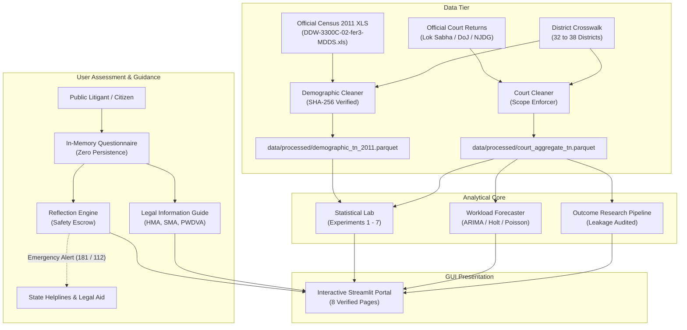

# System Architecture & Technical Specifications

This document outlines the architecture, data flows, module boundaries, and security/privacy guarantees of the Tamil Nadu Divorce and Matrimonial Judicial Analysis platform per Section 12.D.

---

### High-Level System Architecture

---

### Key Architectural Boundaries

1. **Separation of Measurement Scopes:**
   - **Demographic Stock:** Census population snapshot counts (`demographic_marital_status`).
   - **Matrimonial Broad:** Family Court proceedings under Family Courts Act, 1984 (`matrimonial_broad`).
   - **All Civil Cases:** Subordinate judiciary civil backlog from NJDG (`all_cases`).
   - These scopes are kept strictly isolated in data representations to prevent false equivalences.

2. **Feature Leakage Prevention in Outcome Research:**
   - Pre-filing features (marriage duration, statute, petitioner type, counsel representation) are verified by an automated blacklist auditor.
   - Any feature generated after petition presentation (`disposal_date`, `interim_maintenance_ordered`, `final_order_date`) is strictly blocked from the feature matrix.

3. **Privacy and In-Memory Execution:**
   - The Relationship Reflection tool collects no personally identifiable information (PII).
   - Questionnaire responses live solely within the user's active session state in RAM; no external API calls, third-party LLMs, or database persistence mechanisms are utilized.

4. **Safety-First Routing Protocol:**
   - Responses indicating physical violence, coercion, or severe fear bypass normal reflection synthesis and immediately trigger high-visibility emergency safety alerts featuring Tamil Nadu's 24/7 Women Helpline (181) and National Emergency Services (112).
